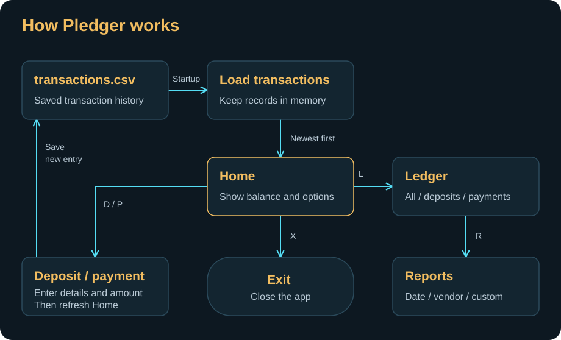

# Pledger — Project Overview

A Java console application for recording deposits and payments, checking your balance, and searching transaction history.

## How it works



1. **Start:** load saved transactions and sort them newest first.
2. **Home:** display the balance; add a deposit, make a payment, open Ledger, or exit.
3. **Ledger:** view all transactions, deposits, or payments.
4. **Reports:** filter by date, search by vendor, or combine optional custom filters.

New transactions are saved immediately and loaded again next time the app starts.

## Run it

Use JDK 17 or newer and Maven. From the project root:

```bash
mvn compile
java -cp target/classes com.pluralsight.Main
```

## The code at a glance

| Class | Job |
| --- | --- |
| `Main` | Starts the app and handles menu navigation. |
| `Transaction` | Holds the date, time, description, vendor, and amount. |
| `Ledger` | Loads and saves transactions, calculates balance, and lists records. |
| `Report` | Filters transactions for reports and searches. |
| `Console` | Reads and validates input. |
| `UI` | Draws the banner, menus, and tables. |

## Data and search

Transactions live in `src/main/resources/transactions.csv`:

```text
date|time|description|vendor|amount
2026-11-01|10:00:00|Client payment|Example Client|100.00
2026-11-01|11:00:00|Office supplies|Example Store|-25.00
```

Deposits are positive; payments are negative. The balance is their sum.

Basic vendor search matches the full name, ignoring case. Custom Search accepts optional start/end dates, description, vendor, and a signed amount. Blank fields are skipped; all supplied filters must match.

## Current limitations

Money uses `double`; file handling and input validation could be improved. There is no transaction editing or deletion.

[10-minute presentation outline](PRESENTATION.md)
