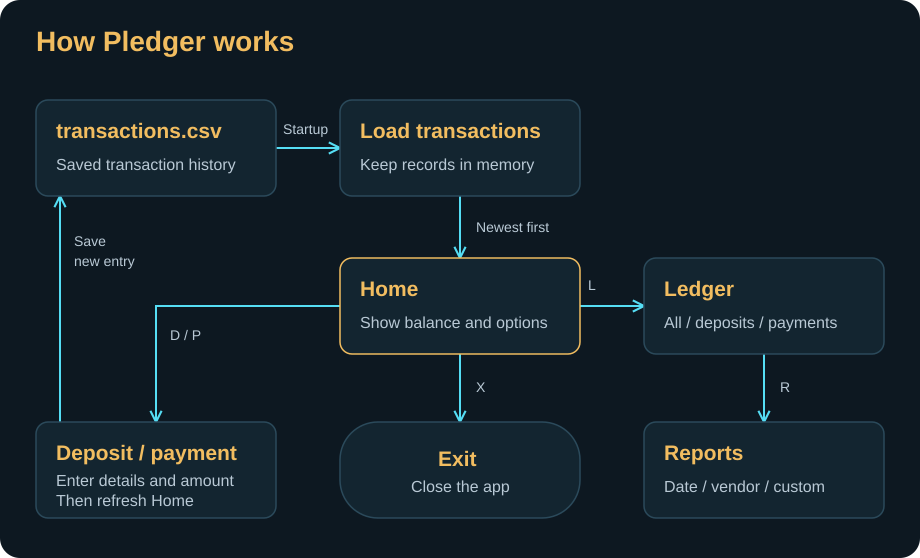

# Pledger

Pledger is a Java 17 command-line ledger for recording deposits and payments, checking your balance, and finding past transactions.

## Documentation

- [Project overview](Documentation/PROJECT.md) — a diagram, quick setup, and a short guide to the code.
- [10-minute presentation](Documentation/PRESENTATION.md) — timed demo outline, edge cases, code walkthrough, and questions aligned with the class rubric.

## Features

- Record deposits and payments with the current local date and time.
- Calculate the balance from all loaded transactions.
- Browse all transactions, deposits, or payments, newest first.
- Generate month-to-date, previous-month, year-to-date, and previous-year reports.
- Search by an exact vendor name or combine optional filters in Custom Search.
- Append transactions to a local file and load them again on startup.

## Run locally

With JDK 17 and Maven installed, run these commands from the repository root:

```bash
mvn compile
java -cp target/classes com.pluralsight.Main
```

Pledger reads and saves transactions in `src/main/resources/transactions.csv`.
Run the application from the repository root so that this relative path resolves correctly. Maven may need internet access to download build plugins on the first build. The application itself has no third-party runtime dependencies.

## Demo walkthrough

1. **Home** — add a deposit, make a payment, and check the updated balance.
2. **Ledger** — view all transactions, deposits, or payments in the same table.
3. **Reports** — run a date report, search by vendor, or combine filters in Custom Search.
4. Restart the app to see the saved balance and transactions.

To see input validation, enter `abc` as an amount or enter a start date after the end date in Custom Search.

## App flow



[Original Excalidraw sketch](Documentation/.obsidian/pledger-flow.excalidraw)

## Code highlight

[`Report.customSearch()`](src/main/java/com/pluralsight/Report.java) accepts optional dates, description, vendor, and amount. A transaction appears in the results only if it matches every filter the user supplied.
