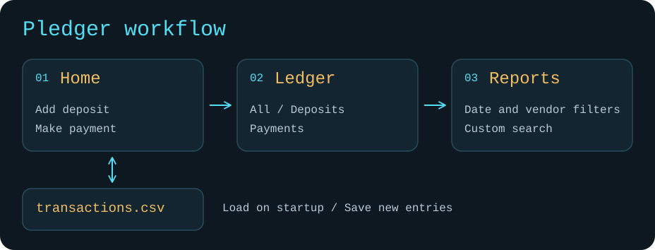

# Pledger

Pledger is a Java 17 command-line ledger for recording deposits and payments, checking your balance, and finding past transactions.

## Run locally

With JDK 17 and Maven installed, run these commands from the repository root:

```bash
mvn compile
java -cp target/classes com.pluralsight.Main
```

Pledger reads and saves transactions in `src/main/resources/transactions.csv`.

## Demo walkthrough

1. **Home** — add a deposit, make a payment, and check the updated balance.
2. **Ledger** — view all transactions, deposits, or payments in the same table.
3. **Reports** — run a date report, search by vendor, or combine filters in Custom Search.
4. Restart the app to see the saved balance and transactions.

To see input validation, enter `abc` as an amount or enter a start date after the end date in Custom Search.

## App flow



[Editable Excalidraw diagram](Documentation/.obsidian/pledger-flow.excalidraw)

## Code highlight

[`Report.customSearch()`](src/main/java/com/pluralsight/Report.java) accepts optional dates, description, vendor, and amount. A transaction appears in the results only if it matches every filter the user supplied.
